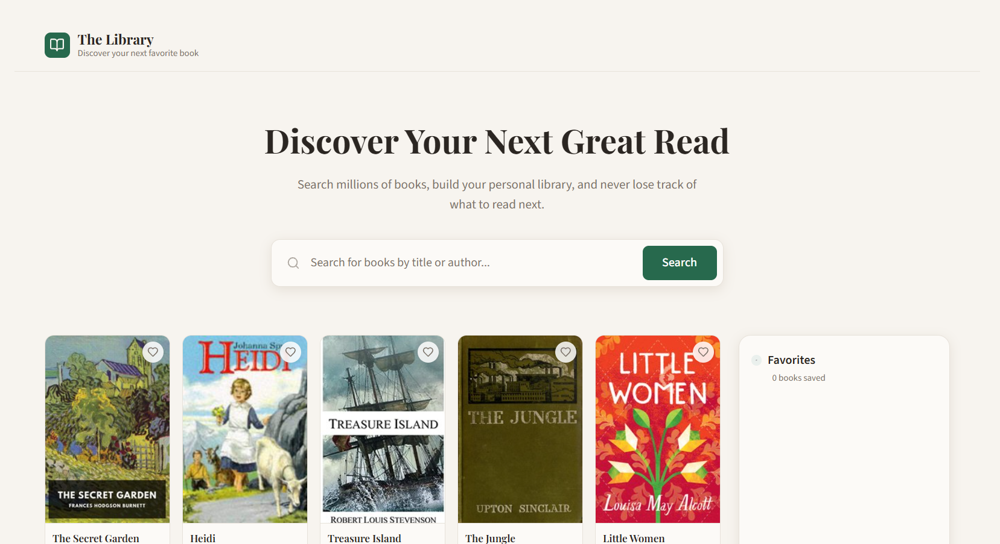

# Book Catalog

## Description

Book Catalog is a small frontend application for browsing and searching books.
Book data is loaded from the Open Library API, and favorite books are saved in the browser.

## Features

- browse a catalog of books loaded from the Open Library API;
- search books by title or author;
- add books to favorites and remove them;
- save favorites to Local Storage, so they persist after a page reload;
- responsive layout for mobile, tablet, and desktop.

## Technologies

- HTML
- CSS
- JavaScript
- Vite
- npm

## Installation and Usage

Clone the repository:

```bash
git clone https://github.com/Andrewbuba123/frontend-roadmap.git
```

Navigate to the project directory:

```bash
cd frontend-roadmap
```

Install dependencies:

```bash
npm install
```

Start the development server:

```bash
npm run dev
```

## Production Build

To create a production build, run:

```bash
npm run build
```

The production files will be generated in the `dist/` directory.

## Screenshots



## Future Improvements

- add sorting;
- add pagination;
- add a separate book details page.
