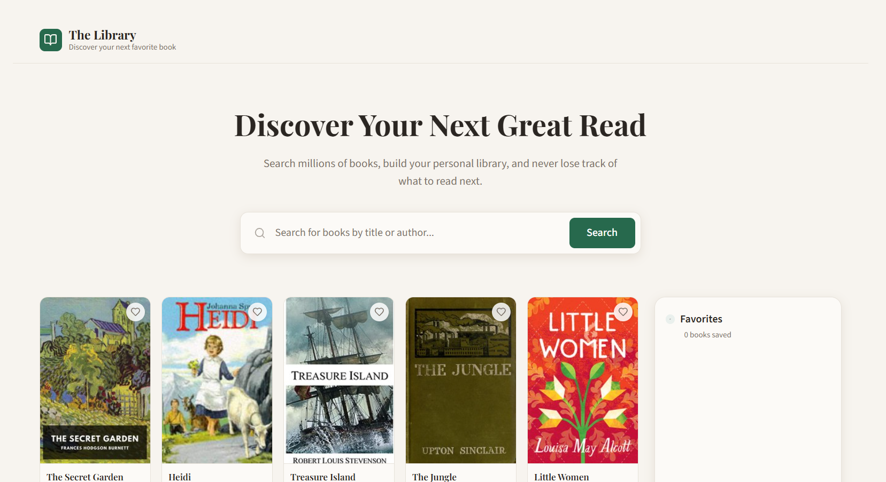

# Book Catalog

## Description

Book Catalog is a small frontend application for browsing and searching books.
In the interface, the app is called **The Library**.
Book data is loaded from the [Open Library API](https://openlibrary.org/developers/api), and favorite books are saved in the browser.

The project and the TypeScript practice lessons were built while following the [Innowise Frontend course](https://innowise-frontend.notion.site/3b21d8d45e0d80f39575c5b8c2c5db70?v=3b21d8d45e0d807e9387000cd684527f).

## Features

- browse a catalog of books loaded from the Open Library API;
- search books by title or author;
- add books to favorites and remove them;
- save favorites to Local Storage, so they persist after a page reload;
- responsive layout for mobile, tablet, and desktop.

## Technologies

- HTML
- CSS
- JavaScript
- Vite
- npm
- TypeScript (practice lessons only, see [TypeScript Practice](#typescript-practice))

## Requirements

- Node.js 20.19+ or 22.12+ (required by Vite)

## Installation and Usage

Clone the repository:

```bash
git clone https://github.com/Andrewbuba123/Book-Catalog.git
```

Navigate to the project directory:

```bash
cd Book-Catalog
```

Install dependencies:

```bash
npm install
```

Start the development server:

```bash
npm run dev
```

## Production Build

To create a production build, run:

```bash
npm run build
```

The production files will be generated in the `dist/` directory.

## TypeScript Practice

The `ts-practice/` folder contains my solutions to the TypeScript lessons (1–22) from the [Innowise Frontend course](https://innowise-frontend.notion.site/3b21d8d45e0d80f39575c5b8c2c5db70?v=3b21d8d45e0d807e9387000cd684527f).
Each `lesson-XX.ts` file corresponds to the lesson with the same number in the course materials.
They are not part of the application and are not included in the production build.

Type-check all lessons:

```bash
npx tsc -p ts-practice
```

Run a single lesson:

```bash
npx tsx ts-practice/lesson-01.ts
```

## Screenshots



## Future Improvements

- add sorting;
- add pagination;
- add a separate book details page.
